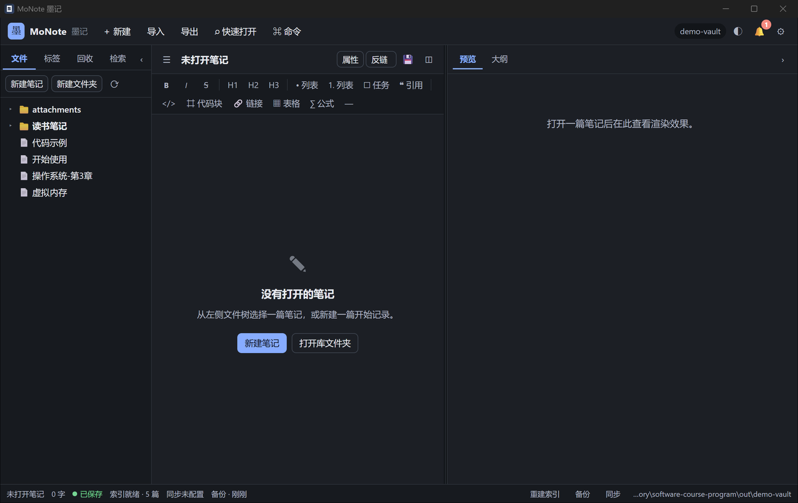
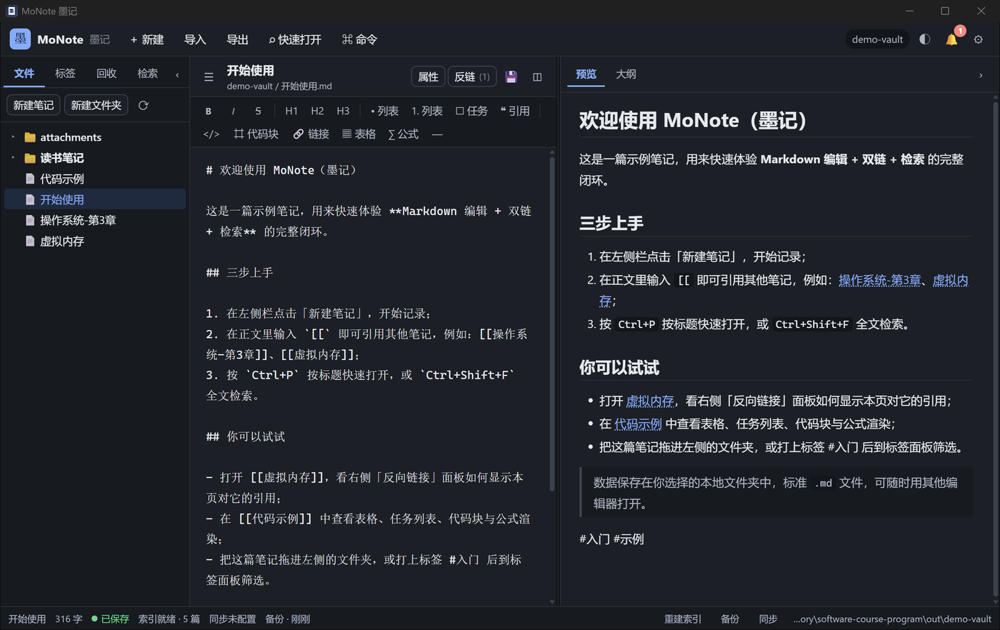
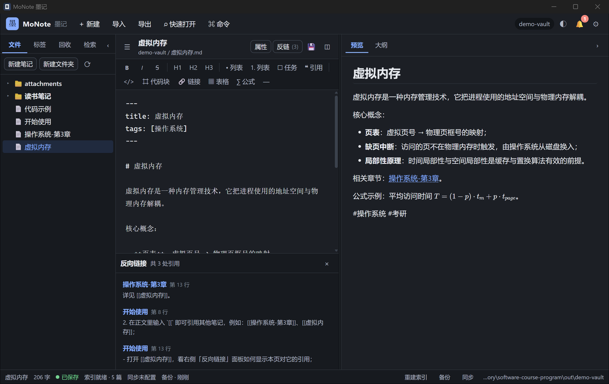
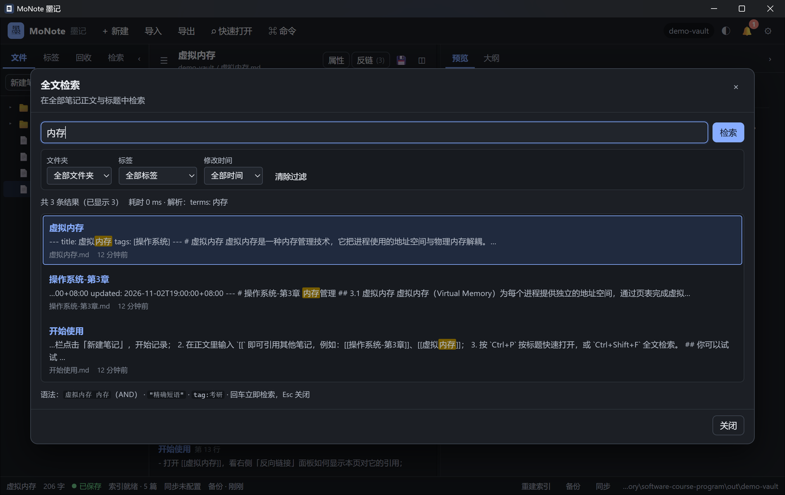
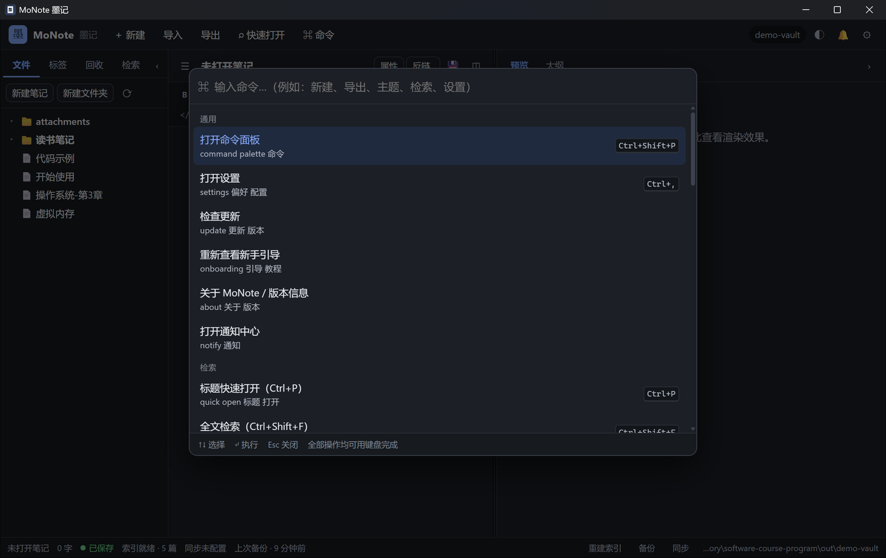
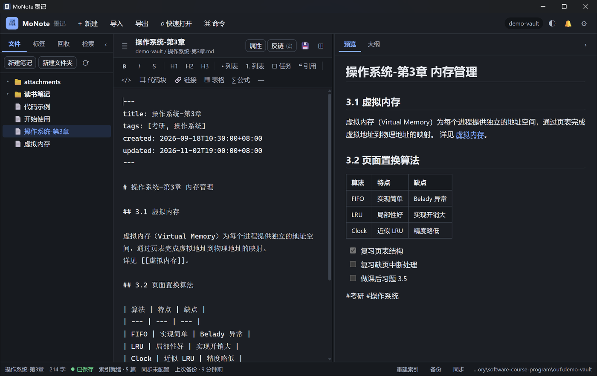
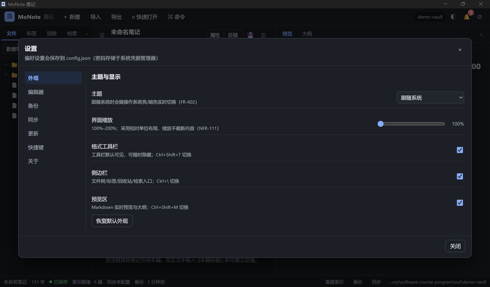
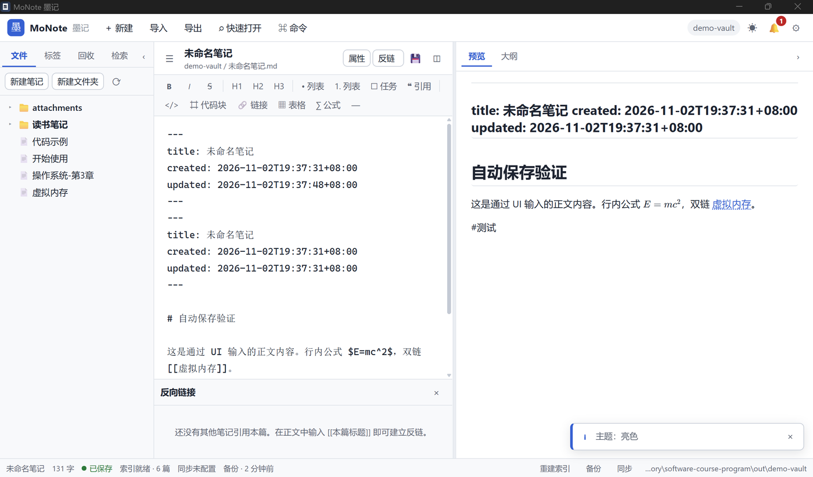

# MoNote（墨记）· 桌面应用实现

> 软件工程 3.0 · 课程项目实现（Tauri 2 + Rust 核心 + WebView 前端）
> 需求基线：《MoNote 需求分析文档》v1.1（`../../monote/docs/01-需求分析文档.md`）
> 设计依据：《MoNote 软件设计文档》v1.0（`../../exp02/docs/01-软件设计文档.md`）

MoNote 是一款**本地优先**的个人 Markdown 笔记与知识管理桌面应用：

- 数据是本地标准 UTF-8 `.md` 文件（YAML front-matter），无格式锁定、卸载不丢数据；
- 三栏编辑体验：Markdown 编辑 + 实时预览 + 大纲，2 秒自动保存、原子写、崩溃安全；
- 知识组织：`[[双链]]` + 反链面板 + 标签聚合 + 文件夹树；
- 快速检索：SQLite FTS5 全文索引（中文按字），标题检索 / 全文检索 / `tag:` 过滤 / 范围过滤；
- 可靠备份：每日自动备份（保留 5 份）、ZIP 导入导出、回收站 30 天自动清理；
- 可选 WebDAV 同步（用户自备服务器，冲突"新者为准 + 冲突副本"，密码存 OS 凭据管理器）。

## 界面预览

| 三栏主界面（暗色） | 笔记编辑 + 实时预览 |
| --- | --- |
|  |  |

| 反链面板 | 全文检索 |
| --- | --- |
|  |  |

| 命令面板 | 表格与任务列表渲染 |
| --- | --- |
|  |  |

| 设置页 | 亮色主题 |
| --- | --- |
|  |  |

> 截图来自真实 Tauri 窗口（release 构建，demo-vault 示例库）。更多验证证据见 [测试报告](docs/测试报告.md)。

## 目录结构

```
monote/app/
├── CONTRACT.md              # 团队开发合同（模块边界 / IPC 合同 / 文件所有权）
├── README.md                # 本文件
├── docs/                    # 实现说明、测试报告
├── scripts/gen-icons.ps1    # 图标生成脚本（已生成 icons/）
├── frontend/                # WebView 前端（纯静态 HTML/CSS/ES Module，离线可用）
│   ├── index.html
│   ├── styles.css
│   ├── js/                  # ES Module 应用代码
│   └── vendor/              # marked / KaTeX 等本地化第三方库（含许可证）
└── src-tauri/               # Rust 核心（Tauri 2）
    ├── Cargo.toml
    ├── tauri.conf.json
    ├── capabilities/
    ├── icons/
    ├── src/
    │   ├── main.rs / lib.rs     # 入口、Tauri Builder、命令注册、启动流程
    │   ├── error.rs             # 统一错误码 + envelope（设计文档 6.1）
    │   ├── types.rs             # DTO 与配置结构（设计文档 6.2/7.4）
    │   ├── state.rs             # AppState 门面（编排 M2~M7）
    │   ├── ipc.rs               # 全部 IPC 命令
    │   ├── watcher.rs           # OS 文件事件 → ExternalGuard → 增量索引
    │   └── core/                # M2 Vault / M3 Link / M4 Search / M5 IO / M6 Backup+Sync / M7 AppCore
    └── tests/integration.rs     # 端到端集成测试
```

## 构建与运行

### 环境要求

| 依赖 | 版本 / 说明 |
| --- | --- |
| Windows | 10+ x64（开发环境 Windows 11） |
| Rust | stable（本机 1.97），target `x86_64-pc-windows-msvc` |
| MSVC | Visual Studio 2022 Build Tools（本机路径 `E:\IDE\Microsoft Visual Studio\18\Community`） |
| WebView2 | Windows 10/11 自带 Edge WebView2 Runtime |
| Node.js | 仅前端第三方库已随仓库附带 vendor 文件，运行不需要 Node |

### 一键构建（PowerShell）

```powershell
cd monote\app\src-tauri
# 先加载 MSVC 环境（路径按本机安装位置调整）
cmd /c "call E:\IDE\Microsoft Visual Studio\18\Community\VC\Auxiliary\Build\vcvars64.bat >nul && cargo build --release"
# 产物：target\release\monote.exe
```

### 开发运行

```powershell
cd monote\app\src-tauri
cmd /c "call E:\IDE\Microsoft Visual Studio\18\Community\VC\Auxiliary\Build\vcvars64.bat >nul && cargo run"
```

首次启动会显示欢迎页：选择一个本地文件夹作为笔记库（或新建），即可开始使用。
配置保存在 `%APPDATA%\MoNote\config.json`；应用不写任何云端，除用户显式配置的 WebDAV 与更新检查外无网络出口。

### 打包安装程序（可选）

```powershell
cd monote\app\src-tauri
# 需要 Tauri CLI：cargo install tauri-cli --version "^2"（或使用 npm 版 @tauri-apps/cli）
cargo tauri build
```

## 测试

```powershell
cd monote\app\src-tauri
cmd /c "call E:\IDE\Microsoft Visual Studio\18\Community\VC\Auxiliary\Build\vcvars64.bat >nul && cargo test"
# 集成测试单独运行（串行，避免测试间互相干扰）
cmd /c "call ... && cargo test --test integration -- --test-threads=1"
```

测试分层（设计文档 13.3）：各模块单元测试（链接解析/front-matter/路径安全/回收站/FTS 检索/查询语法/编码嗅探/同步三方比对/配置恢复）+ 集成测试（建库→写入→双链→检索→重命名→回收站→备份→导出→索引重建闭环）。

## 快捷键（默认，可在设置中自定义）

| 快捷键 | 功能 |
| --- | --- |
| `Ctrl+P` | 标题快速打开 |
| `Ctrl+Shift+F` | 全文检索 |
| `Ctrl+Shift+P` | 命令面板 |
| `Ctrl+N` | 新建笔记 |
| `Ctrl+S` | 立即保存 |
| `Ctrl+\` | 折叠/展开侧栏 |
| `Ctrl+Shift+M` | 折叠/展开预览 |
| `Ctrl+,` | 设置 |

## 与设计文档的对应关系

| 设计文档 | 实现位置 |
| --- | --- |
| 3 架构（L1~L5、分层规则） | `frontend/`（L1/L2）+ `src-tauri/src/{state,ipc,core}`（L3/L4） |
| 4 模块 M1~M7 | `frontend/js/{editor,preview,sidebar,search,...}.js`、`src-tauri/src/core/{vault,links,index,io,backup,sync,config,notify,update}.rs` |
| 5 关键流程 F-01~F-08 | `state.rs`（写/读/检索/备份/同步编排）、`watcher.rs`（外部改动） |
| 6 接口（IPC en封套、22+ 命令、事件） | `ipc.rs`、`CONTRACT.md` 第 5 节 |
| 7 数据（index.db schema、sync-state、config） | `core/index.rs`、`core/sync.rs`、`core/config.rs`、`types.rs` |
| 8 界面（UR-01~08） | `frontend/index.html`、`frontend/styles.css`、`frontend/js/*` |
| 10 异常（X-1~X-14） | 原子写、索引降级、回收站、同步冲突、配置损坏恢复等（见 `docs/实现说明.md`） |

## 已知限制（诚实声明）

- WebDAV 同步已实现客户端与三方比对逻辑，但本轮未接入真实远端服务做端到端验证；首次使用请先用测试服务器验证。
- PDF 导出沿用设计决策 DD-6：调用 WebView 打印管线（前端 `window.print()`），排版精细度受限，不内置 headless 浏览器。
- 跨平台（macOS/Linux）代码层面已按条件编译/平台路径实现，但仅在 Windows 上构建与验证。
- 性能指标（AC-024~027）在设计文档的基准环境与 1 万篇数据集上验收；本仓库附小规模冒烟数据（见 `docs/测试报告.md`）。

## 许可与第三方库

- 应用代码：课程作业用途。
- 第三方库：`frontend/vendor/LICENSES.md` 列出 marked、KaTeX 等版本与许可证；Rust 依赖见 `src-tauri/Cargo.toml`。
